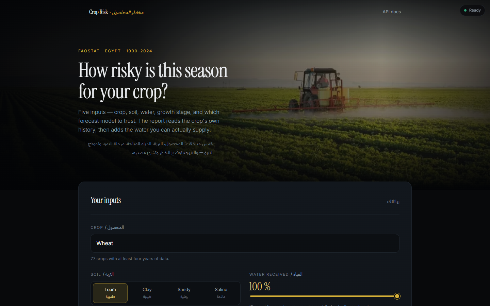
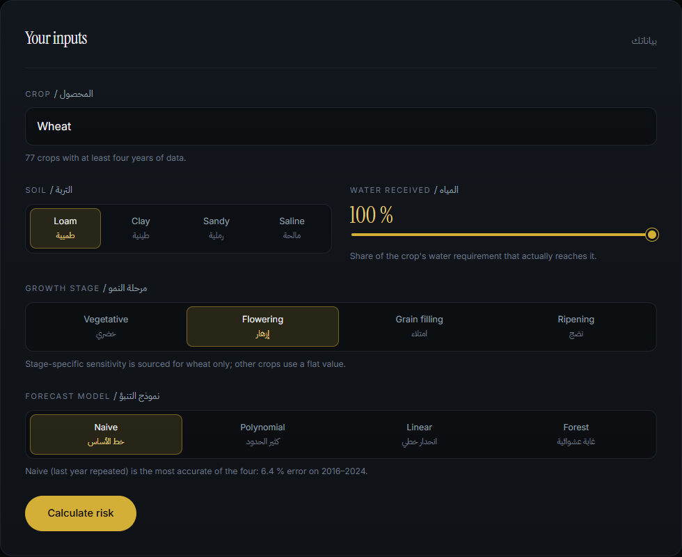
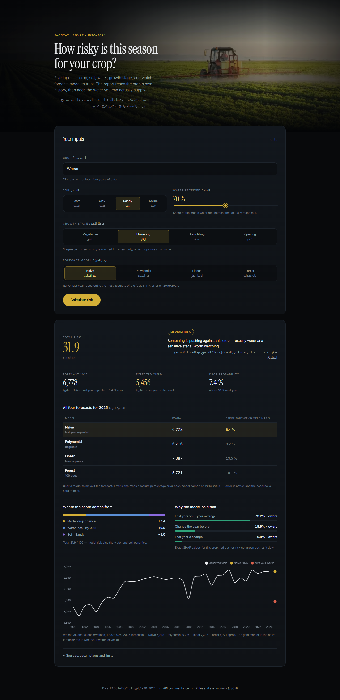

# Egypt Crop Risk — API + interface

**Live:** <https://mohamed-sherif-data--crop-api.modal.run> · **Docs:** [`/docs`](https://mohamed-sherif-data--crop-api.modal.run/docs) · **Source:** <https://github.com/mohamed-sherif-data/crop-risk-api>

The crop-risk notebook (`crop_project_short.ipynb`) and its Streamlit app, rebuilt as
one FastAPI service with two faces:

- a **web interface** where a visitor picks five things — crop, soil, water, growth
  stage and forecast model — and gets one report;
- a **JSON API** on the same origin that a phone app, a dashboard or a notebook can
  call directly.

Same data, same models, same honest numbers. No Streamlit, no `shap`, no matplotlib.



## The interface

Five inputs, nothing else. The page opens on Wheat, full water, flowering and the
naive model — the sensible default — and recalculates the moment anything changes.

| Input | What it means |
|---|---|
| Crop | 77 crops with at least four years of data, type-ahead over the FAOSTAT list |
| Soil | Loam / Clay / Sandy / Saline |
| Water received | 40–100 % of the crop's requirement, a slider |
| Growth stage | Vegetative / Flowering / Grain filling / Ripening |
| Forecast model | Naive (last year repeated) / Polynomial (degree 2) / Linear / Random forest |



The report answers, in this order: the total score out of 100 and its band, the
forecast from the model you picked, the expected yield after your water level, the
probability of a >10 % drop, where the score came from, why the model said it, and
the yield history with the chosen forecast and your watered-down yield drawn on the
end of the line.

Switching the model re-asks the API immediately — the toggle never shows a cached
number next to a new label, and the hint under it quotes that model's out-of-sample
error so a weaker choice is visible before you read the yield.

Under the figures, all four results sit side by side in one small table: the 2025
yield each model predicts and the error it earned, with the active one highlighted.
Clicking a row switches the forecast, so the comparison and the control can never
disagree.



Every report repeats its own assumptions, so a guess never looks like a source.
The chart is the only remote dependency (Chart.js from a CDN); the rest of the page
is served by the same container as the API, with `no-store` on the HTML so a
redeploy can never leave a stale page behind.

## Call the API

The sliders are one `POST /v1/risk/report` request:

```bash
curl -s -X POST https://mohamed-sherif-data--crop-api.modal.run/v1/risk/report \
  -H "Content-Type: application/json" \
  -d '{"crop": "Wheat", "soil": "Sandy", "water_percent": 70, "stage": "flowering", "forecast_model": "poly"}'
```

```json
{
  "crop": "Wheat",
  "target_year": 2025,
  "latest_yield_kg_ha": 6777.7,
  "forecast_model": "poly",
  "forecast_label": "Polynomial regression (degree 2)",
  "forecast_kg_ha": 6716.0,
  "expected_yield_kg_ha": 5406.4,
  "forecasts": [
    {"model": "naive", "value_kg_ha": 6777.7, "mape_pct": 6.38, "...": "..."},
    {"model": "poly", "value_kg_ha": 6716.0, "mape_pct": 8.25, "...": "..."},
    {"model": "linear", "value_kg_ha": 7386.9, "mape_pct": 13.55, "...": "..."},
    {"model": "forest", "value_kg_ha": 5721.1, "mape_pct": 10.08, "...": "..."}
  ],
  "model_risk_pct": 7.35,
  "water_loss_pct": 19.5,
  "soil_points": 5.0,
  "total_score": 31.85,
  "risk_level": "medium",
  "ky": 0.65,
  "drivers": [
    {"feature": "gap", "share_pct": 73.2, "direction": "lowers", "...": "..."},
    {"feature": "ch2", "share_pct": 19.9, "direction": "lowers", "...": "..."},
    {"feature": "ch1", "share_pct": 6.8, "direction": "lowers", "...": "..."}
  ],
  "assumptions": ["..."]
}
```

## Run it locally

```bash
py -m pip install -r requirements-dev.txt  # runtime + pytest/httpx
py -m pytest -q                             # 26 contract tests

py -m uvicorn api.main:app --port 8100      # interface at /, docs at /docs, reload off
fastapi dev api/main.py                     # reload on save
fastapi run api/main.py                     # production
```

`scikit-learn` is pinned in `requirements.txt` because the forest's trees change
between releases; the pinned version keeps the local, Docker and Modal scores
identical. `requirements-dev.txt` adds the test packages, and `Dockerfile` and
`scripts/modal_app.py` both install the same runtime file.

## Endpoints

| Method | Path | Answers |
|---|---|---|
| GET | `/` | The interface itself (`web/index.html`) |
| GET | `/v1/health` | Is the service up, and how big is the dataset? |
| GET | `/v1/meta` | Split year, thresholds, soils, stages, Ky values, assumptions |
| GET | `/v1/crops` | The 77 usable crops with their history span |
| GET | `/v1/crops/{item}/history` | Annual yield series for one crop |
| POST | `/v1/risk/report` | The farmer report: risk, expected yield, drivers |
| GET | `/v1/risk/ranking?limit=10` | Crops most likely to drop more than 10 % |
| GET | `/v1/models/metrics` | Out-of-sample scores for naive / polynomial / linear / random forest, and the risk model |
| GET | `/docs` | Swagger UI generated from the same schemas |

Interactive docs: **`/docs`**. Machine-readable: `/openapi.json`.

## What the service promises

- **Year-based split, never random.** Fit on ≤ 2015, judge on 2016–2024, so no
  future information reaches training.
- **Scaling after the split.** `StandardScaler` is fitted on training rows only.
- **The baseline is served as the forecast, and every alternative is one request
  away.** Next year = last year won on the held-out years: MAPE 6.4 %, against
  8.2 % for polynomial regression (degree 2), 10.1 % for random forest and 13.6 %
  for linear regression. `/v1/models/metrics` publishes all four, each report
  repeats the same errors next to its own values, and the toggle lets you see the
  disagreement for yourself. A degree-3 polynomial scored 14.7 % and is not served.
- **Explanations are exact, not approximate.** For a logistic regression, SHAP
  values are `coef_j × (x_j − mean_j)` in log-odds, which is what
  `shap.LinearExplainer` computes. Doing it in closed form drops a heavy
  dependency and keeps the report reproducible to the last decimal.

## The risk rules, and which parts are guesses

| Part | Formula | Status |
|---|---|---|
| Model risk | logistic regression on `ch1`, `ch2`, `gap` | fitted, weak signal (AUC ≈ 0.60) |
| Water loss | `Ky × (100 − water_percent)` | FAO Ky for wheat; `Ky = 1.0` for other crops is an assumption |
| Soil points | Sandy 5, Saline 8, Loam/Clay 0 | **assumption, no source** |
| Total | `min(model + water + soil, 100)` | presentation choice |

Every report carries those assumptions in its own `assumptions` array, so a
client can never present a guess as a sourced number.

`Ky` for wheat by stage: vegetative 0.2, flowering 0.65, grain filling 0.55,
ripening 0.1 (FAO; ripening is the loosest of the four).

## Project layout

```
engine.py                  data + models + report logic (importable, testable)
api/main.py                FastAPI app, lifespan, cache policy, static mount
api/schemas.py             request/response contract
web/index.html             the interface
web/styles.css             ink + gold, segmented controls, responsive
web/app.js                 submit → POST /v1/risk/report → render
data/…Raw.csv              FAOSTAT export
tests/test_api.py          26 contract tests, including the notebook's worked examples
scripts/modal_app.py       Modal deploy, label crop-api (keeps the same URL)
scripts/check_ui.py        34 browser assertions against local or live
scripts/screenshots.py     regenerates the images in docs/media/
docs/media/live/           screenshots taken from the deployed service
requirements.txt           runtime pins (scikit-learn pinned for stable scores)
requirements-dev.txt       the above plus pytest and httpx
```

## Tests

```bash
py -m pytest -q                              # 26 passed
py -m uvicorn api.main:app --port 8100       # then, in another shell:
py scripts/check_ui.py                       # 34 browser checks, local
py scripts/check_ui.py https://mohamed-sherif-data--crop-api.modal.run   # and live
```

The API tests pin the notebook's numbers: naive MAPE 6.38 %, risk AUC 0.597, base
rate 8.58 %, riskiest decile 22.4 %, and Farmer B's total score of 31.85 / 100.
The browser tests pin the same number through the interface (31.9 shown), plus
the phone layout, the chart, the drivers and the unknown-crop refusal.

## Put it on GitHub

The project carries no secrets — the Modal token lives in your own
`~/.modal.toml`, never in the repo. So a fresh clone can go straight up:

```bash
git init
git add .
git commit -m "Egypt crop risk: FastAPI service and interface"
gh repo create egypt-crop-risk --public --source=. --push
```

Without `gh`: create the empty repository on github.com, then
`git remote add origin <url> && git push -u origin main`.
`.gitignore` already keeps `__pycache__/`, `.pytest_cache/`, `.venv/`,
`dist/` and `.verify/` out of the history.

## Deploy

The public URL is a Modal web endpoint labelled `crop-api`:

```bash
py -m modal deploy scripts/modal_app.py
```

That label can only belong to one app at a time, so the previous project
(`egypt-crop-analytics`) was stopped with
`py -m modal app stop --yes egypt-crop-analytics` to free
`mohamed-sherif-data--crop-api`. Redeploying the older project restores it, but it
would take the label back and this service would need a different one.

The same app also runs anywhere with Docker:

```bash
docker build -t crop-risk-api .
docker run -p 8000:8000 crop-risk-api
```

## الخلاصة بالعربي

الخدمة على نفس الرابط: **https://mohamed-sherif-data--crop-api.modal.run** — بقى
فيها صفحة عربية/إنجليزية بسيطة يختار فيها الزائر أربع حاجات (المحصول، التربة،
المياه، مرحلة النمو) وتطلع له النتيجة بالأسباب، وتحتها نفس الـ API لأي عميل.

أهم نقطتين:

1. **التوقع الأساسي هو Naive** (السنة القادمة = السنة الحالية) لأنه كان الأدق
   فعلاً على 2016–2024 (خطأ 6.4 %)، لكن فيه زرار تبديل بين أربع نماذج:
   Naive، Polynomial (درجة 2)، Linear، Random forest — وكل واحد بيظهر جنبه
   خطؤه الحقيقي، والـ API بيقول الأرقام كلها في `/v1/models/metrics`.
2. **أي رقم مبني على افتراض مكتوب صراحة** جوه كل رد في `assumptions` — نقاط
   التربة و`Ky` لغير القمح لسه محتاجين مصدر.
